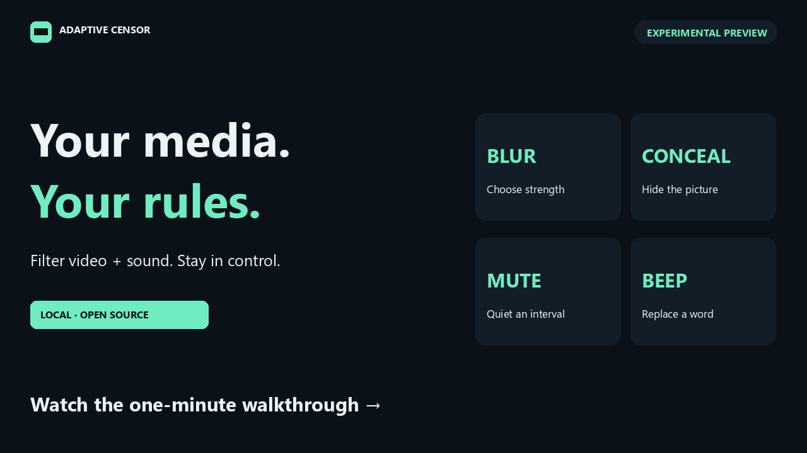

# Adaptive Censor

### Keep the story. Choose what gets through.

A local video and podcast player that **analyzes ahead, applies your picture and sound rules, and lets you correct the timeline**. Choose what to allow, blur, conceal, mute or beep—without making a new edit of the source for every preference.

[](docs/media/adaptive-censor-demo.mp4)

**[Watch the 63-second demo](docs/media/adaptive-censor-demo.mp4)** · **[Download the preview](https://github.com/razahashmi/Adaptive-Censor/releases/tag/v0.3.0-preview.1)** · [Why we're building this](docs/PROJECT_WRITEUP.md) · [Contribute](CONTRIBUTING.md)

[](https://github.com/razahashmi/Adaptive-Censor/actions/workflows/ci.yml)

> **Experimental preview.** Detection can miss content or filter a clean scene. Review the timeline before relying on it. Scene suggestions require confirmation by default.

## Your boundaries, your settings

Allow kissing. Blur violence lightly. Conceal a reviewed sexual-activity interval and mute its sound. Beep only the words on your list. Each category has its own picture and sound rules.

| Control | What it does |
|---|---|
| **Blur or conceal** | Choose blur strength or an opaque picture; filter the whole scene or a supported region. |
| **Mute or beep** | Use your word/phrase list and exceptions, or apply sound rules to an accepted scene interval. |
| **Compare side by side** | View the original and filtered picture at the same playback position. |
| **Fix the timeline** | Exclude a false match, confirm a suggestion, add a missed interval or select a region. |
| **Report while watching** | One click saves a local mistake report; optionally retain a short evidence clip. |
| **Save or export** | Reopen local sessions or export a filtered MP4 for another device. |

Supported categories are **anatomy/nudity, sexual activity, violence, gore, kissing, language and custom visual concepts**. These are separate controls, with different detection methods and limitations. Kissing is separate from sexual activity. Automatic moving-object segmentation remains research work. [Full behavior and category guide](docs/USER_GUIDE.md).

## Try it

The tested base is **Windows + 64-bit Python 3.13**. Start with CPU setup; GPU and research environments are optional.

1. Download and extract the complete **[Windows setup ZIP](https://github.com/razahashmi/Adaptive-Censor/releases/download/v0.3.0-preview.1/adaptive-censor-0.3.0-preview.1-windows-setup.zip)**.
2. Open **Adaptive Censor Setup.exe**, choose a writable folder and select **Set up**. The helper requires Python 3.13 and downloads pinned dependencies separately.
3. Select **Open player**, then **Try the 12-second controls demo**. Leave the base-model download option unchecked for this first controls-only run.

The setup helper is unsigned. Independent clean-Windows and full native-GUI validation are still pending. [Installation and troubleshooting](docs/INSTALLATION.md) · [Hardware and downloads](docs/HARDWARE.md).

<details>
<summary><strong>Prefer running from source?</strong></summary>

With Git and Python 3.13 installed, open PowerShell:

```powershell
git clone https://github.com/razahashmi/Adaptive-Censor.git
cd Adaptive-Censor
.\Setup.ps1 -SkipModels
.\Start.ps1
```

Open **http://127.0.0.1:8502/**. Stop the service with `Stop.ps1`.

</details>

The controls demo exercises playback and effects without recognition. To analyze your own media, add the base models through the setup helper or run `Setup.ps1` in the application folder. Import a local file, select the installed analysis passes, analyze, then review and play. The optional visual sequence verifier needs a separate setup and NVIDIA GPU. [Model card](docs/MODEL_CARD.md).

## Analyze ahead. Filter during playback.

The player targets **30 seconds ahead of your playhead**, adjustable to 6, 15, 30 or 60 seconds. It processes six-second chunks with surrounding context, caches the results and advances the analysis window as you watch.

**Import → analyze ahead → review events → apply your rules → watch or export.**

For a local file, playback can begin once roughly six seconds are ready while analysis works toward the selected lookahead. If processing falls behind, the player pauses before the unanalyzed section. Sustained processing still needs to keep pace; a larger buffer cannot fix a permanently slower pipeline.

Speech analysis finds timestamps for your selected words. Visual analysis proposes categorized intervals and, where available, regions. The player applies your current effects at those timestamps. Changing a playback rule does not rerun detection or re-encode the source. Changing analysis settings may require a new scan. [Architecture](docs/ARCHITECTURE.md) · [Project write-up](docs/PROJECT_WRITEUP.md).

## What works—and what still needs work

| Area | Current evidence |
|---|---|
| Player, policy, review and export | 223 local runtime tests completed with seven optional skips; 53 browser-module tests passed. Fresh CPU environment, startup, export and restart checks passed. |
| Automatic recognition | Experimental. Independent, representative category-level accuracy has not been established. This is not a validated child-safety filter. |
| Public CPU diagnostic | Five licensed clips, 26 seconds total, processed in 11.84 seconds including startup on one Ryzen 9 9950X3D machine. Draft labels; already inspected development examples. |
| GPU, long-running live use and other systems | Need broader independent testing. The short CPU diagnostic is not a sustained live or multi-user capacity result. |

[Reproducible benchmark and exact configuration](docs/BENCHMARKS.md) · [Known limitations](LIMITATIONS.md) · [Validation details](RELEASE_STATUS.md).

Speech currently uses English models. Mute/beep replaces the **whole audio mix** during the selected interval; it does not separate a speaker from background music. Blur can leave recognizable shapes; concealment is the opaque option. Timing coverage and pixel coverage are different measurements.

## Make the next version better

A correction should be easy to make and useful to investigate. **Wrongly censored** and **Missed something** save local reports at the current playback time. You can review them, keep optional context, and deliberately prepare precise labels. Reports do not upload or train a model automatically.

High-value contributions:

- **Test installation and recovery** on another Windows machine, with sanitized steps and hardware details.
- **Review the licensed starter examples** and add permitted positives and confusing clean examples.
- **Improve detection with evidence:** separate training/evaluation titles, measure false filtering and misses, and check the intended pixels.
- **Improve the experience:** accessibility, keyboard controls, clearer errors and measured performance work.

[Start contributing](CONTRIBUTING.md) · [Six scoped starter tasks](docs/STARTER_TASKS.md) · [Roadmap](docs/ROADMAP.md) · [Report a problem](https://github.com/razahashmi/Adaptive-Censor/issues/new/choose).

## Home use

Today, analyze on one computer and export a filtered MP4 for your other devices. Authenticated household streaming, profiles and supported clients are planned. This preview listens on this computer's loopback address; a supported home server needs additional access controls, streaming and capacity work. [Home-server direction](docs/USER_GUIDE.md#using-it-around-the-home).

## Privacy and licenses

Local-file analysis uses local models. There is no application telemetry, cloud inference subscription or automatic report upload. Setup/model downloads and optional stream URLs use the network. Media copies, transcripts, detections and reports remain in the local runtime until removed. [Privacy](PRIVACY.md) · [Security](SECURITY.md).

Original code is under the **[MIT License](LICENSE)**. Dependencies and models retain their own terms: [Notices](NOTICE.md). The demo uses Anna Tarazevich / Pexels footage under the Pexels License and *Tears of Steel* / Blender Foundation footage under CC BY 3.0. The poster is original MIT artwork. [Creators, licenses and changes](docs/MEDIA_CREDITS.md).

The demo uses reviewed timings to demonstrate actual effects and edited authentic UI captures; its false-match example is staged. It does not measure recognition accuracy. [Captions](docs/media/adaptive-censor-demo.vtt) · [Transcript](docs/DEMO_TRANSCRIPT.md).

The public distribution excludes private media, private datasets and labels, downloaded weights, runtime environments and private development history. Please attach only sanitized, lawfully redistributable examples to public issues.
