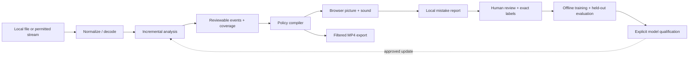

# Architecture and contributor map

The player and research tools share inference code but have different responsibilities. Start here before changing a detector.

## Where to work

| Area | Entry points | Responsibility |
|---|---|---|
| Player / API | `server.py`, `web/app.mjs`, `web/policy.mjs` | Local sessions, controls, coverage, playback and export |
| Filtering | `core.py` | Event validation, independent picture/audio policy and real FFmpeg output |
| Inference | `analysis_engine.py`, `detectors.py`, `anatomy_runtime.py`, `scene_verifier.py` | Decode, word timestamps, nearby-frame evidence and candidate verification |
| User corrections | `playback_feedback.py`, `feedback_evidence.py`, `web/feedback*.mjs` | Local reports, optional retained context and precise review tasks |
| Research | `learned*.py`, `finetune.py`, `attention*.py`, `segmentation*.py` | Optional models and data tools; these are not all enabled in playback |
| Evaluation | `evaluate*.py`, `public_benchmark.py`, `provenance.py` | Timing, temporal metrics, masks, model identities and title separation |
| Distribution | `build_source_release.py`, `windows_bootstrap.py`, `build_windows_release.py` | Reviewed source and CPU setup launcher |

A scene candidate is not an accepted filtering decision. Unconfirmed suggestions do not filter. Coverage is committed after enabled passes succeed; playback waits at an unfinished boundary. Rule changes compile an existing timeline, while changes to inference settings invalidate relevant analysis.

Keep code organization stable during this preview: imports and research scripts currently use the repository root. A future package-layout migration should be a separate change with import and installation checks.

## Useful checks

- Player/renderer changes: `test_core.py`, `test_engine.py`, browser policy tests and extracted-release smoke.
- Feedback changes: feedback/evidence/labeling tests plus a disposable local review session.
- Model changes: exact model/config identity, independent title-separated labels, temporal and pixel metrics, and complete pipeline speed. Passing code tests does not qualify a model.
- Packaging changes: `test_release.py`, bootstrap/public-benchmark tests, archive verification and fresh-runtime startup.
