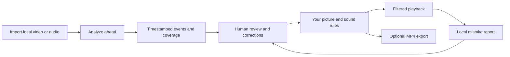

# Adaptive Censor: a player that follows your rules

Different viewers can want different things from the same video. Someone may want to allow a kiss, soften a violent scene, conceal graphic imagery and beep a short word list. A podcast listener may care only about language. Those preferences belong in settings that are easy to inspect and change.

Adaptive Censor explores that idea as a local video and podcast player. It analyzes ahead of playback, builds a timeline of candidate events, and applies the viewer's chosen picture and sound rules. The timeline is editable because a detector's decision should be open to correction.

This first release is an experimental preview for early testers and contributors. The player and feedback workflow have automated checks; recognition quality still needs substantial work. It is not a validated child-safety product.

[Watch the 63-second demonstration](media/adaptive-censor-demo.mp4) · [Try the preview](https://github.com/razahashmi/Adaptive-Censor/releases/tag/v0.3.0-preview.1) · [Contribute](../CONTRIBUTING.md).

## Preferences are separate from predictions

The useful unit is a timestamped event: a category, a start and end, supporting evidence and sometimes a region. A policy then decides what happens during that event.

That separation lets two people use different settings on the same reviewed timeline. One can allow kissing while filtering sexual activity. Another can lightly blur a violent interval and keep its sound. A third can conceal the picture and mute the interval. Changing an effect does not require running the model again or creating another version of the original file.

The current picture choices are allow, adjustable blur and opaque concealment. Sound independently stays on, is muted, or is replaced by a beep. Anatomy detection can provide regional boxes, and the reviewer can select a rectangle manually. General moving-object segmentation remains research work: a box that exists is not proof that it covers the correct pixels throughout a scene.

For language, local English speech recognition supplies word timestamps. A word/phrase list chooses matches and an exception list reduces unwanted ones. The filter replaces the whole audio mix during a matching interval. It does not isolate a speaker or preserve music underneath a removed word.

## How the sliding lookahead works

The default analysis target is 30 seconds ahead of the playhead. The engine processes six-second chunks, with up to two seconds of surrounding context on each side for relevant passes. It keeps completed results and advances the work queue as playback moves. The model is not repeatedly asked to rescan the entire 30 seconds.

For an imported file, the player can start once roughly six seconds are ready while analysis builds toward the selected target. An optional full-file scan can continue beyond that window. Coverage is committed only after the enabled passes finish successfully. If analysis falls behind, playback pauses before an unanalyzed boundary. Audio also has a scheduled cutoff at the coverage boundary.

A buffer absorbs temporary slowdowns. It cannot make a pipeline that is consistently slower than playback sustainable. Ordinary live input also needs playback delay to create an analyzed reserve; there is no way to inspect content that has not arrived. Live-stream support remains experimental.

Import first prepares a local playback copy. This is an application workflow, with its own player, rather than a claim that every app on a computer is automatically filtered.

## Corrections are part of the product

A useful filtering player needs more than a sensitivity slider. It needs a clear path from a wrong prediction to a correction.

The viewer can compare the original and filtered picture at the same playback position, exclude a false match, confirm a suggestion, add a missed interval, adjust timing or select a region. Unconfirmed scene suggestions do not filter by default. An experimental automatic scene option exists, but it does not turn a weak detector into a reliable one.

**Wrongly censored** and **Missed something** save a report at the current playback time. An optional short local evidence clip can preserve context for later review. Keeping a clip is an explicit choice, and reports can contain private information. Nothing is automatically uploaded.

A report is also not a training label. The intended improvement path is deliberate:

1. Inspect the report and its permitted source context.
2. Mark exact intervals or pixels, including ambiguous and clean examples.
3. Keep training and evaluation titles separate.
4. Train or tune a candidate offline.
5. Compare misses, unnecessary filtering, region coverage, speed and resource use.
6. Explicitly qualify a particular model and configuration before enabling it.

The repository contains labeling, evaluation and research tools for this work. It does not silently retrain from each click or ship private training data.

## What the evidence says today

There are two separate questions: does the software implement its rules correctly, and do the models identify the right content?

Local validation completed 223 runtime tests, with seven optional training-dependency skips, and all 53 browser-module tests passed. Fresh CPU-environment and extracted-package checks exercised startup, local authentication, feedback, optional retained clips, review guards, export and persistence after restart. Those results support the player and distribution behavior; they do not establish recognition accuracy.

The public starter pack has five licensed clips totaling 26 seconds from two already inspected sources. Its annotations are explicitly assistant drafts. A CPU diagnostic on one Ryzen 9 9950X3D processed the pack in 11.84 seconds, including startup. That small run is useful for reproducing behavior and finding problems. It is not a representative benchmark, sustained live test or minimum hardware requirement.

The [benchmark page](BENCHMARKS.md) publishes the exact configuration, model/dependency identities, draft category support, missed time and unnecessary filtering. Unknown categories stay unknown. The organ-prop example is not treated as independent graphic-injury ground truth, and the action clip still needs review. Temporal coverage does not establish pixel coverage.

The [known limitations](../LIMITATIONS.md) also describe sparse prior development evidence. There is no supported 95% accuracy claim. Model proposals should improve the evidence, rather than turn one favorable clip into a headline percentage.

## Local operation, with explicit boundaries

Ordinary local-file analysis uses local models. The application has no automatic report upload or application telemetry. Installing dependencies, downloading models and opening optional stream URLs do make network requests. Local copies, transcripts, detections and reports remain in the runtime until removed.

The preview binds to loopback. Today, home use means analyzing on one computer and exporting a filtered MP4 for another device or an existing media server.

A supported household server needs authenticated clients, profile permissions, secure streams, a bounded job queue, cache/model versioning and measured multi-viewer capacity. A source timeline could be analyzed once and reused with different household rules. Server-rendered streams could serve devices that cannot apply effects themselves. Those are development goals, not features obtained merely by changing the listening address. Universal filtering of protected streaming services is outside this preview.

## Why publish this now?

An open repository gives people something concrete to inspect: how lookahead is scheduled, how a policy resolves overlapping events, how feedback becomes a review task, and which evidence is missing. It also makes it easier to contribute a small improvement without needing access to anyone's private media library.

The highest-value next steps are independent Windows installation reports, carefully reviewed public examples across more titles, better regional supervision, stronger speech evaluation and measured performance on other hardware. Accessibility, recovery and clearer error handling matter alongside model work.

The source distribution includes code, documentation and a narrow set of credited demonstration assets. Private film/TV collections, private datasets and labels, model weights, runtime environments and private development Git history are excluded. The optional public starter and demo-input packs have their own source terms and manifests.

Original code is under the [MIT License](../LICENSE). Dependencies, models and demo footage retain their separate terms. The video credits Anna Tarazevich / Pexels and *Tears of Steel* / Blender Foundation; its timings are manually reviewed, and its false-match example is deliberately staged. It demonstrates the controls and real rendering, not automatic detection quality.

If you want to help, pick a [scoped starter task](STARTER_TASKS.md), review the [architecture map](ARCHITECTURE.md), or try a [clean installation](CLEAN_INSTALL_CHECKLIST.md). Bring a reproducible problem, permitted examples and measurements. The goal is a filtering player whose choices can be understood, corrected and improved.
